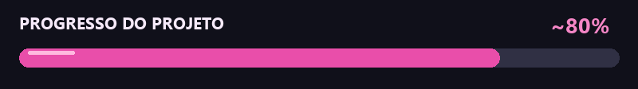

# 🇧🇷 P1nkman VI

### Um projeto brasileiro de compatibilidade Xbox Series para Windows

> 🟢 **Este é o único repositório oficial do P1nkman:** [github.com/P1nkmanVI/P1nkman](https://github.com/P1nkmanVI/P1nkman).

O P1nkman reúne trabalho da comunidade para tornar uma experiência de Xbox Series acessível no PC com Windows, a partir dos arquivos do jogo que cada pessoa já possui. Esta edição parte do **cool_fox**, da família [VIctory](https://github.com/Marvisak/VIctory), e acrescenta a identidade P1nkman e a barra de desempenho em português.

> **Projeto experimental.** Ainda existem falhas de imagem, travamentos e oscilações de desempenho. Não somos afiliados à desenvolvedora nem à distribuidora do jogo. Este repositório não contém arquivos do jogo.

📣 Acompanhe: [X / Twitter](https://x.com/p1nkman_VI) · [Telegram](https://t.me/p1nkmanVI)

## 🚀 Nossa evolução

Começamos em 24 de novembro de 2026 testando diferentes bases, ajustes gráficos e formas de reduzir travamentos. Avançamos da abertura até trechos do modo história, testamos a navegação na água e chegamos à cidade. Também experimentamos correções para controles, rosto e memória em versões anteriores.

Nesta nova base estamos priorizando a continuidade dos testes no **perfil Series S**, usando o conjunto `pareto-residency` do cool_fox. A janela mostra FPS, tempo por quadro, pior quadro recente, estimativas de GPU e CPU, RAM do processo, draws e tempo de execução.

**Desempenho relatado:** o criador observou cerca de **15 FPS em modo história**. Essa é uma observação de teste, não uma garantia para toda a campanha ou para outras máquinas; ainda faltam registrar cena, duração, configuração e medições detalhadas para uma comparação reproduzível. Há também relatos anteriores mais lentos em outras builds e cenas.

## 📊 Progresso



**~80% — estimativa subjetiva do criador**, apresentada como visão geral do andamento. Não é porcentagem de funcionalidades verificadas, de campanha concluída, de compatibilidade nem previsão de prazo. A barra é visual; o valor pode ser alterado em `scripts/gerar-progresso.py` e o GIF regenerado com Pillow.

### O que ainda estamos investigando

- Manchas pretas, sombras em blocos, geometria ausente e texturas que chegam tarde.
- Fluidez e estabilidade em cenas diferentes, com tempo de quadro e testes repetíveis.
- Iluminação e ray tracing: o teste anterior com RT terminou em erro; a causa ainda não foi confirmada.
- Compatibilidade de controle, áudio, saves e cenas ao longo da história nesta base.

Resultados de versões anteriores são parte da evolução do projeto, mas não demonstram automaticamente o funcionamento de cada recurso nesta edição. Comparações de FPS precisam da mesma cena, configuração, hardware e estado de cache.

## 💻 Requisitos

- Windows 10/11 x64, CPU com AVX2 e GPU Direct3D 12 com Shader Model 6.6 e mesh shaders.
- Uma cópia própria e completa do jogo para Xbox Series, em pasta separada.
- Rust via rustup e Visual Studio Build Tools com desenvolvimento C++ e Windows SDK.
- Espaço em disco para compilação e caches. Uso de RAM e VRAM varia bastante com a cena; PCs com 32 GB de RAM podem enfrentar pressão de memória.

## 🔨 Compilar

No PowerShell, em uma pasta de trabalho sua:

```powershell
git clone https://github.com/P1nkmanVI/P1nkman.git
cd P1nkman
powershell -ExecutionPolicy Bypass -File .\Initialize-FormatTables.ps1
cargo build --release --locked -p victory
```

O script baixa as tabelas BCPack da origem indicada nele e confere seu SHA-256. Elas ficam locais e fora do Git; não são cobertas pela licença deste repositório. Caso você já tenha um checkout compatível com a tabela, use `-FromCheckout 'C:\caminho\do\checkout'` no mesmo script para copiá-la com verificação.

O executável compilado fica em `target\release\victory.exe`. Sem o compilador de recursos `rc.exe`, a compilação continua, mas o executável pode ficar sem o ícone.

## ▶️ Iniciar

Abra `iniciar-p1nkman.cmd` em um editor de texto e altere o caminho padrão `C:\Jogos\MeuJogo` para a pasta que contém `game_scarlett_master.exe`. Salve e dê dois cliques no iniciador. Também é possível definir o caminho só para a sessão do PowerShell:

```powershell
$env:VICTORY_GAME_DIR = 'C:\Jogos\MeuJogo'
.\iniciar-p1nkman.cmd
```

O iniciador usa dados e cache próprios em `%LOCALAPPDATA%\P1nkman-Coolfox`, faz backup dos saves existentes antes de iniciar e grava os logs em sua subpasta `logs`. Um save de outra instalação não é importado automaticamente. Não limpe caches para comparar testes sem anotar isso; a primeira execução pode compilar shaders e pipelines e demorar mais.

Para quem quiser experimentar a cidade, há um pacote de save **opcional e separado**, quando disponibilizado pelo projeto. A instalação padrão não o importa: uma instalação nova pode começar a história do início. Leia as instruções do pacote e faça backup antes de substituir qualquer save; a compatibilidade ainda precisa ser verificada.

## 🤝 Como ajudar

Relatos e contribuições são bem-vindos. Ao informar um problema, inclua a versão do projeto, CPU, GPU, RAM, driver, modo, cena, tempo por quadro e o que apareceu na tela. Compare execuções na mesma cena e remova dados pessoais antes de compartilhar logs. Não publique arquivos do jogo, saves, dumps ou shaders extraídos.

Quem quiser contribuir com código pode trabalhar em uma cópia, documentar a origem das mudanças e propor uma alteração por vez, com testes e evidências. A documentação técnica e as ferramentas herdadas estão em `docs/` e `xtask/`.

## 🙏 Créditos e licença

- [cool_fox](https://github.com/DoubleGhosty/cool_fox), base desta edição; o ZIP usado foi identificado com o commit `f4b48ad766ddbec1a1867022cd42f7645b0dd55e`.
- [VIctory](https://github.com/Marvisak/VIctory), por Marvisak e colaboradores, e [fxceless/victory-fork](https://github.com/fxceless/victory-fork), de onde vêm partes fundamentais da base.
- DexNom, Belobug, Joshua Odom, Geckomacabre e demais colaboradores citados na [documentação da base](README.coolfox.md).
- A barra e a identidade P1nkman foram adaptadas ao código da base para este projeto.

Este pacote é um **retrato de código** baseado no commit indicado, não uma cópia completa do histórico Git original. Para autoria e histórico detalhados, consulte os projetos de origem. O código está sob **GPL-3.0-or-later**; consulte [LICENSE](LICENSE). As tabelas BCPack obtidas separadamente não são abrangidas por essa licença, conforme [docs/asset-policy.md](docs/asset-policy.md).
